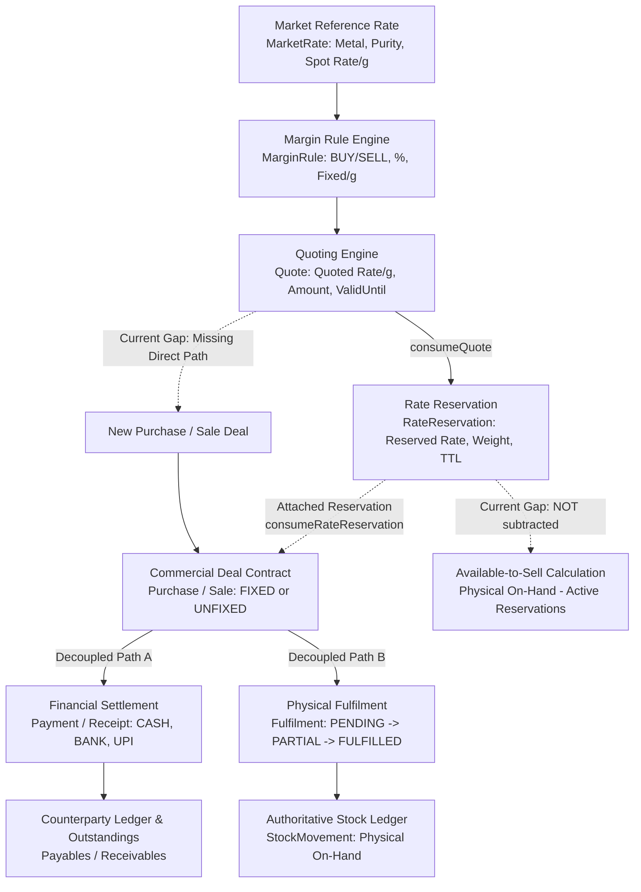

# BULLION — V3.6 PRE-IMPLEMENTATION GAP MAPPING
## Commercial Lifecycle + Business Logic Final Audit

**Repository:** `https://github.com/Sriikaran/Bulion`  
**Target File:** `Bullion/BULLION_V3_FINAL_GAP_AUDIT.md`  
**Audit Target Path:** `c:\Users\srika\OneDrive\Desktop\pawnify\Bullion`  
**Date of Audit:** October 5, 2026  
**Audit Type:** STRICT AUDIT-ONLY (No code, schema, migration, or UI modifications)  
**Baseline Specification:** *"Bullion Module — Developer Requirements / Bullion Trading — Business Logic & Developer Action Guide"*  
**Verification Baseline:** Full inspection of schemas, services, server actions, client pages, database invariants, and the 294 passing automated tests across 12 test suites.

---

# 1. Executive Summary

Over successive development sprints, the Bullion system has evolved from its initial Core V1 foundation into an advanced precious metals commercial platform:
- **V1 (Core Operations):** Bullion Masters (`Metal`, `Purity`), Counterparties, Invoicing (`Purchase`, `Sale`), Authoritative Append-Only Physical Stock Ledger (`StockMovement`), Stock Adjustments, Opening Stock, 8 Core Business Intelligence Reports, CSV Exports, and Server-Side RBAC.
- **V2 (Financial Settlement):** Counterparty Payables and Receivables, Payment/Receipt Cash-Flow Ledger (`Payment`), Outstanding Balances, Chronological Running Account Ledgers.
- **V3.1 (Unfixed Rates & Rate Fixing):** Separation of commercial rate status (`RateStatus.FIXED` vs `RateStatus.UNFIXED`), weight-locking with floating prices, subsequent atomic rate fixing (`fixPurchaseRate`, `fixSaleRate`).
- **V3.2 (Physical Fulfilment Decoupling):** Separation of commercial contract creation from physical vault inventory movements via `Fulfilment` (`PENDING`, `PARTIALLY_FULFILLED`, `FULFILLED`).
- **V3.3 (Rate Blocks & Reservations):** First-class `RateReservation` allowing temporary locking of rates and quantities with TTL expiration.
- **V3.4 (Market Reference Rates):** Canonical spot reference rates for Gold and Silver (`MarketRate`) with historical effective-window tracking.
- **V3.5 (Margin & Quoting Engine):** Configurable `MarginRule` engine and snapshot `Quote` generation for commercial desk pricing.

### Key Audit Verdict:
The codebase has implemented the core structural capabilities with exceptional engineering hygiene:
- 100% TypeScript type-safety (0 errors).
- Strict IEEE-754 floating-point avoidance (100% `Decimal.js` math with `Decimal.ROUND_HALF_UP`).
- Append-only physical stock ledger integrity (`StockMovement`).
- Strict repository isolation (zero imports or runtime dependencies on Pawnify).
- 294/294 passing automated unit tests across 12 test suites.

### Critical Deficiencies & Architectural Gaps Identified for V3.6:
While individual modules are functional, **a critical integration disconnect exists between the Quoting/Reservation layer and the Commercial Deal Creation layer**:
1. **Quote $\rightarrow$ Deal Workflow is Broken/Missing:** A `Quote` can currently only be consumed into a `RateReservation`. There is no direct workflow to convert a `Quote` into a commercial `Purchase` or `Sale`.
2. **Rate Block / Reservation Semantic Misalignment:** In `reservation-service.ts`, reservations were primarily built as sub-records attached to an *existing* UNFIXED deal (`purchaseId` or `saleId`). While V3.5 allows `Quote` to create a reservation with null deal IDs, `RateReservation` lacks a direct `counterpartyId` relation. Furthermore, consuming an unlinked reservation merely sets its status to `CONSUMED` without creating or binding any purchase or sale!
3. **Stock Reservation vs Physical Stock (`Available-to-Sell`):** The system maintains physical inventory on-hand in `StockMovement`. However, neither `assertSufficientStock` nor `CurrentStockReport` subtracts active reservations from physical stock. The business rule:
   $$\text{Available-to-Sell} = \text{Physical On-Hand} - \text{Active Reservations}$$
   is **not calculated or enforced**.
4. **Deal Lifecycle Lacks Unified State & Deal Closure:** Deals never transition to `CLOSED`. When an invoice is 100% fulfilled and 100% settled, it remains permanently in `POSTED`. State is fragmented across 4 separate enum fields without a unified lifecycle machine.
5. **Cancellation Ignores Completed Financial Settlements:** Cancelling a posted purchase or sale reverses physical stock movements (if fulfilled), but completely ignores existing completed payments. This orphans cash flows and distorts counterparty debt calculations.
6. **Report Distortion from Unfixed Deals:** Existing reports (Supplier-wise, Buyer-wise, Comparative Flow, Bullion Profit) calculate weighted average rates by dividing fixed amounts by total weights (including unfixed weights), producing mathematically distorted averages.
7. **Rate Cut/Uncut & Preclosure:** Correctly remain unimplemented as **BUSINESS DECISION REQUIRED**.

---

# 2. Current Architecture Flow

The existing multi-stage pipeline across V1, V2, and V3 operates as follows:



### Critical Flow Observations:
- **Canonical Decoupling:** Deal agreement, physical delivery, and monetary settlement are correctly decoupled at the data layer.
- **Missing Forward Bridge:** The flow dead-ends between `Quote`/`RateReservation` and commercial deal initiation. Operators cannot select an active Quote or Rate Block to generate an invoice.
- **Stock Disconnect:** Physical stock ledger is append-only, but the reservation layer does not feed back into inventory availability checks.

---

# 3. Complete Requirement Matrix

The 29 core business requirements from the *“Bullion Trading — Business Logic & Developer Action Guide”* have been audited against the current repository state:

| # | Requirement | Source Requirement | Current Implementation | Status | Evidence / Files | Gap Identified | Recommended Next Action |
|---|---|---|---|:---:|---|---|---|
| **1** | **Fixed-rate purchase workflow** | Immediate spot purchase with fixed rate, weight, total, supplier association. | Full creation, validation, draft, and posting lifecycle. | ✅ COMPLETE | [purchase-service.ts](file:///c:/Users/srika/OneDrive/Desktop/pawnify/Bullion/src/lib/services/purchase-service.ts#L51-L188), [validations/purchase.ts](file:///c:/Users/srika/OneDrive/Desktop/pawnify/Bullion/src/lib/validations/purchase.ts), `b1-domain.test.ts` | None for fixed purchases. | Preserve current logic. |
| **2** | **Unfixed-rate purchase workflow** | Lock quantity with floating price; `ratePerGram` & `totalAmount` remain null; rate fixed later. | Implemented via `rateStatus: UNFIXED`. Total remains null until fixed. | ✅ COMPLETE | [purchase-service.ts](file:///c:/Users/srika/OneDrive/Desktop/pawnify/Bullion/src/lib/services/purchase-service.ts#L60-L75), [schema.prisma](file:///c:/Users/srika/OneDrive/Desktop/pawnify/Bullion/prisma/schema.prisma#L378), `b6-rate-fixing.test.ts` | None. Safe against zero/null fabrication. | Preserve current logic. |
| **3** | **Fixed-rate sale workflow** | Spot sale entry with buyer, fixed rate, stock verification, and posting. | Full creation, stock verification during fulfilment, and posting. | ✅ COMPLETE | [sale-service.ts](file:///c:/Users/srika/OneDrive/Desktop/pawnify/Bullion/src/lib/services/sale-service.ts#L51-L187), [validations/sale.ts](file:///c:/Users/srika/OneDrive/Desktop/pawnify/Bullion/src/lib/validations/sale.ts), `b1-domain.test.ts` | None for fixed sales. | Preserve current logic. |
| **4** | **Unfixed-rate sale workflow** | Booking weight sold with floating rate; valuation deferred. | Implemented via `rateStatus: UNFIXED`. Valuation null; physical delivery supported. | ✅ COMPLETE | [sale-service.ts](file:///c:/Users/srika/OneDrive/Desktop/pawnify/Bullion/src/lib/services/sale-service.ts#L60-L75), [schema.prisma](file:///c:/Users/srika/OneDrive/Desktop/pawnify/Bullion/prisma/schema.prisma#L431), `b6-rate-fixing.test.ts` | None. | Preserve current logic. |
| **5** | **Rate fixing** | Atomic fixing of unfixed deals; computes final contract value; stores timestamp & actor. | `fixPurchaseRate` and `fixSaleRate` calculate total with row locking. | ✅ COMPLETE | [purchase-service.ts](file:///c:/Users/srika/OneDrive/Desktop/pawnify/Bullion/src/lib/services/purchase-service.ts#L195-L294), [sale-service.ts](file:///c:/Users/srika/OneDrive/Desktop/pawnify/Bullion/src/lib/services/sale-service.ts#L193-L292), `b6-rate-fixing.test.ts` | None. | Preserve current logic. |
| **6** | **Market reference rate** | Canonical benchmark rate for Gold/Silver per gram across purities with effective dates. | `MarketRate` model, CRUD, scheduled activation, and audit logging. | ✅ COMPLETE | [market-rate-service.ts](file:///c:/Users/srika/OneDrive/Desktop/pawnify/Bullion/src/lib/services/market-rate-service.ts), [market-rate-actions.ts](file:///c:/Users/srika/OneDrive/Desktop/pawnify/Bullion/src/lib/actions/market-rate-actions.ts), `b9-market-rate.test.ts` | None. Does not mutate transactions. | Preserve current logic. |
| **7** | **Margin configuration** | Rules per metal, purity, direction (BUY/SELL), % or fixed/g margin, effective dates. | `MarginRule` model, directional math ($BUY = Ref - M$, $SELL = Ref + M$). | ✅ COMPLETE | [margin-service.ts](file:///c:/Users/srika/OneDrive/Desktop/pawnify/Bullion/src/lib/services/margin-service.ts), [margin-actions.ts](file:///c:/Users/srika/OneDrive/Desktop/pawnify/Bullion/src/lib/actions/margin-actions.ts), `b10-margin-quoting.test.ts` | None. | Preserve current logic. |
| **8** | **Quote generation** | Dynamic calculation from active Market Rate + Margin Rule with validity TTL. | `calculateQuote`, `createQuote`, lazy expiration, and audit logs. | ✅ COMPLETE | [quote-service.ts](file:///c:/Users/srika/OneDrive/Desktop/pawnify/Bullion/src/lib/services/quote-service.ts#L112-L208), [quote-actions.ts](file:///c:/Users/srika/OneDrive/Desktop/pawnify/Bullion/src/lib/actions/quote-actions.ts), `b10-margin-quoting.test.ts` | None. | Preserve current logic. |
| **9** | **Rate block / reservation** | Customer locks rate & weight for a defined time window before commercial deal booking. | `RateReservation` model implemented, but tightly coupled to existing deals. | ⚠️ IMPLEMENTED BUT SEMANTICALLY INCORRECT | [reservation-service.ts](file:///c:/Users/srika/OneDrive/Desktop/pawnify/Bullion/src/lib/services/reservation-service.ts#L117-L302), [schema.prisma](file:///c:/Users/srika/OneDrive/Desktop/pawnify/Bullion/prisma/schema.prisma#L646-L694) | `RateReservation` requires existing `purchaseId`/`saleId` in `createRateReservation`. Standalone reservations lack `counterpartyId` and cannot be converted into a deal. | Refactor `RateReservation` to support standalone counterparty rate locks and direct conversion into deals. |
| **10** | **Reservation expiry/release** | Lapsed reservations auto-expire and release held weight/rate capacity. | Lazy expiration on query/mutation via `expireOverdueReservations`. | ✅ COMPLETE | [reservation-service.ts](file:///c:/Users/srika/OneDrive/Desktop/pawnify/Bullion/src/lib/services/reservation-service.ts#L67-L111), `b8-rate-reservation.test.ts` | None. Expiration is atomic and audited. | Preserve current logic. |
| **11** | **Physical fulfilment** | Physical vault delivery/receipt separated from deal; writes `StockMovement`. | `Fulfilment` model, `fulfilPurchase`, `fulfilSale`. Writes `StockMovement` on delivery. | ✅ COMPLETE | [fulfilment-service.ts](file:///c:/Users/srika/OneDrive/Desktop/pawnify/Bullion/src/lib/services/fulfilment-service.ts#L60-L330), `b7-fulfilment.test.ts` | None. | Preserve current logic. |
| **12** | **Partial fulfilment** | Multiple physical deliveries against a single contract up to agreed weight. | Tracks `fulfilledWeight` and updates `fulfilmentStatus` (`PARTIALLY_FULFILLED`). | ✅ COMPLETE | [fulfilment-service.ts](file:///c:/Users/srika/OneDrive/Desktop/pawnify/Bullion/src/lib/services/fulfilment-service.ts#L134-L180), `b7-fulfilment.test.ts` | None. Excess deliveries blocked. | Preserve current logic. |
| **13** | **Payment / receipt records** | Cash-flow vouchers tracking outward supplier payments & inward customer receipts. | `Payment` model with `PAYMENT` and `RECEIPT` types, modes, and voucher numbers. | ✅ COMPLETE | [settlement-service.ts](file:///c:/Users/srika/OneDrive/Desktop/pawnify/Bullion/src/lib/services/settlement-service.ts#L130-L355), `b5-financial-settlement.test.ts` | None for deal-linked payments. | Preserve current logic. |
| **14** | **Partial and multiple payments** | Split payments and installments with over-settlement prevention. | Tracks `totalPaid` against `totalAmount`; updates `paymentStatus` (`PARTIALLY_PAID`). | ✅ COMPLETE | [settlement-service.ts](file:///c:/Users/srika/OneDrive/Desktop/pawnify/Bullion/src/lib/services/settlement-service.ts#L182-L215), `b5-financial-settlement.test.ts` | None. Blocks over-payment. | Preserve current logic. |
| **15** | **Party outstanding** | Counterparty net receivables, payables, and exposure derived from transactions and payments. | `getCounterpartyOutstandingsReport` aggregates posted deals and completed payments. | ✅ COMPLETE | [settlement-service.ts](file:///c:/Users/srika/OneDrive/Desktop/pawnify/Bullion/src/lib/services/settlement-service.ts#L570-L670), `b5-financial-settlement.test.ts` | Excludes unfixed quantity exposure; ignores unallocated advances. | Retain; add quantity exposure in V3.6. |
| **16** | **Party ledger** | Chronological running debit/credit journal of purchases, sales, payments, receipts. | `getCounterpartyLedgerReport` builds complete audit-compliant ledger with running balances. | ✅ COMPLETE | [settlement-service.ts](file:///c:/Users/srika/OneDrive/Desktop/pawnify/Bullion/src/lib/services/settlement-service.ts#L675-L870), `b5-financial-settlement.test.ts` | None. | Preserve current logic. |
| **17** | **Stock movement** | Append-only ledger of signed physical weight movements (`StockMovement`). | Authoritative single source of truth for physical inventory. | ✅ COMPLETE | [stock-service.ts](file:///c:/Users/srika/OneDrive/Desktop/pawnify/Bullion/src/lib/services/stock-service.ts#L47-L125), [schema.prisma](file:///c:/Users/srika/OneDrive/Desktop/pawnify/Bullion/prisma/schema.prisma#L320-L360), `stock-logic.test.ts` | None. | Preserve current logic. |
| **18** | **Stock reservation vs physical stock** | Enforce $\text{Available-to-Sell} = \text{Physical On-Hand} - \text{Active Reservations}$. | Current system only tracks Physical On-Hand in `StockMovement`. | ⚠️ IMPLEMENTED BUT SEMANTICALLY INCORRECT | [stock-service.ts](file:///c:/Users/srika/OneDrive/Desktop/pawnify/Bullion/src/lib/services/stock-service.ts#L316-L329), [report-service.ts](file:///c:/Users/srika/OneDrive/Desktop/pawnify/Bullion/src/lib/services/report-service.ts#L422) | `assertSufficientStock` and `CurrentStockReport` do NOT subtract active reservations from physical stock. Overselling reserved capacity is possible. | Implement `Available-to-Sell` deduction in `stock-service.ts` and add reserved stock column to Current Stock report. |
| **19** | **Deal lifecycle** | Coherent flow: `DRAFT -> OPEN/UNFIXED -> FIXED -> PART-SETTLED -> FULFILLED -> CLOSED`. | State is fragmented across `status`, `rateStatus`, `paymentStatus`, `fulfilmentStatus`. | 🟡 PARTIALLY COMPLETE | [schema.prisma](file:///c:/Users/srika/OneDrive/Desktop/pawnify/Bullion/prisma/schema.prisma#L388-L398), [purchase-service.ts](file:///c:/Users/srika/OneDrive/Desktop/pawnify/Bullion/src/lib/services/purchase-service.ts) | No unified `DealStatus` state machine; no `CLOSED` state; terminal state uncoordinated. | Add computed or explicit DealStatus state coordinator in V3.6. |
| **20** | **Closing a deal** | Terminal transition for 100% fulfilled and settled contracts (or preclosed contracts). | No `CLOSED` enum value or closure action exists. | ❌ MISSING | [schema.prisma](file:///c:/Users/srika/OneDrive/Desktop/pawnify/Bullion/prisma/schema.prisma#L31-L35) (`TransactionStatus` has only `DRAFT`, `POSTED`, `CANCELLED`) | Fully paid and fulfilled deals remain `POSTED` forever. | Introduce `CLOSED` state and `closeDealAction`. |
| **21** | **Cancellation / reversal** | Non-destructive cancellation with compensating stock & financial reversals. | Admin cancellation implemented for purchases, sales, fulfilments, and payments. | 🟡 PARTIALLY COMPLETE | [purchase-service.ts](file:///c:/Users/srika/OneDrive/Desktop/pawnify/Bullion/src/lib/services/purchase-service.ts#L300-L388), [sale-service.ts](file:///c:/Users/srika/OneDrive/Desktop/pawnify/Bullion/src/lib/services/sale-service.ts#L298-L386) | Cancelling a purchase or sale with completed payments leaves orphaned cash vouchers, corrupting outstandings. | Enforce payment refund/cancellation check before permitting deal cancellation. |
| **22** | **Auditability** | Append-only audit log of all domain events with actor, timestamps, and JSON snapshots. | `writeAudit` logs all creates, updates, cancellations, postings, and expirations. | ✅ COMPLETE | [audit-service.ts](file:///c:/Users/srika/OneDrive/Desktop/pawnify/Bullion/src/lib/services/audit-service.ts), [schema.prisma](file:///c:/Users/srika/OneDrive/Desktop/pawnify/Bullion/prisma/schema.prisma#L504-L553) | None. | Preserve current logic. |
| **23** | **Decimal-safe calculations** | Zero floating-point arithmetic; exact decimal representation for rates and weights. | `Decimal.js` used everywhere (4 dp for weight/rates, 2 dp for INR monetary values). | ✅ COMPLETE | `stock-service.ts`, `purchase-service.ts`, `quote-service.ts`, `helpers.test.ts` | None. | Preserve current logic. |
| **24** | **Concurrency & duplicate protection** | Row-level locking and transaction guards against overselling and race conditions. | `SELECT ... FOR UPDATE` on purity, deals, and vouchers; status transition assertions. | ✅ COMPLETE | `stock-service.ts` (L308), `purchase-service.ts` (L214), `sale-service.ts` (L212), `b4-hardening.test.ts` | None. | Preserve current logic. |
| **25** | **Existing registers/reports** | Reports remain mathematically correct across V2 and V3 data changes. | 8 core reports exist, but weighted averages distort with unfixed transactions. | 🟡 PARTIALLY COMPLETE | [report-service.ts](file:///c:/Users/srika/OneDrive/Desktop/pawnify/Bullion/src/lib/services/report-service.ts#L600-L620), [report-service.ts](file:///c:/Users/srika/OneDrive/Desktop/pawnify/Bullion/src/lib/services/report-service.ts#L1123) | Unfixed deals with ₹0 totalAmount skew weighted average rates; profit report ignores unfixed inventory. | Update report aggregations to isolate fixed vs unfixed weight and disclose pending valuations. |
| **26** | **Historical rate immutability** | Once fixed, deal rates and completed payments never mutate when market rates update. | Static rates stored on `Purchase`, `Sale`, `RateReservation`, and `Payment`. | ✅ COMPLETE | [schema.prisma](file:///c:/Users/srika/OneDrive/Desktop/pawnify/Bullion/prisma/schema.prisma#L380), `market-rate-service.ts`, `margin-service.ts` | None. Market rates never touch transaction tables. | Preserve current logic. |
| **27** | **Rate Cut / Uncut** | Formula and accounting effects for uncut bullion settlement. | None. Formula explicitly undefined in source guide. | 🔵 BUSINESS DECISION REQUIRED | [BULLION_REQUIREMENTS_GAP_ANALYSIS.md](file:///c:/Users/srika/OneDrive/Desktop/pawnify/Bullion/BULLION_REQUIREMENTS_GAP_ANALYSIS.md#L121) | Formula, purity deduction, and journal entries are undefined by business stakeholders. | Keep BLOCKED until business provides specification. |
| **28** | **Preclosure / early settlement** | Premature termination of open deals with difference settlement. | None. Mentioned only as a phrase in the source guide without business rules. | 🔵 BUSINESS DECISION REQUIRED | Not implemented. | Conditions, penalty/MTM formulas, refund rules, and accounting vouchers are undefined. | Keep BLOCKED until business specifies preclosure rules. |
| **29** | **Quote $\rightarrow$ Deal conversion** | Commercial desk workflow to convert an active Quote directly into a Purchase or Sale deal. | Quoting engine stops at `RateReservation`. No conversion to Purchase/Sale exists. | ❌ MISSING | [quote-service.ts](file:///c:/Users/srika/OneDrive/Desktop/pawnify/Bullion/src/lib/services/quote-service.ts#L256-L374), [quote-actions.ts](file:///c:/Users/srika/OneDrive/Desktop/pawnify/Bullion/src/lib/actions/quote-actions.ts) | Operators must manually re-type quote parameters into purchase/sale forms. | Implement atomic `convertQuoteToDealAction` in V3.6. |

---

# 4. Commercial Lifecycle Assessment

### Source Requirement:
A coherent bullion deal lifecycle:
$$\text{DRAFT} \longrightarrow \text{OPEN / UNFIXED} \longrightarrow \text{FIXED} \longrightarrow \text{PART-SETTLED} \longrightarrow \text{FULFILLED} \longrightarrow \text{CLOSED}$$
and exceptional termination:
$$\text{CANCELLED / REVERSED}$$

### Current Repository Architecture:
The current codebase does NOT have a single `DealStatus` enum. Instead, state is represented by a 4-dimensional composite:
1. `TransactionStatus`: `DRAFT`, `POSTED`, `CANCELLED`
2. `RateStatus`: `FIXED`, `UNFIXED`
3. `SettlementStatus`: `UNPAID`, `PARTIALLY_PAID`, `PAID`
4. `FulfilmentStatus`: `PENDING`, `PARTIALLY_FULFILLED`, `FULFILLED`, `CANCELLED`

### Lifecycle Evaluation:
```
+---------------------+-------------------+------------------+------------------+---------------------+
| Target State        | TransactionStatus | RateStatus       | SettlementStatus | FulfilmentStatus    |
+---------------------+-------------------+------------------+------------------+---------------------+
| DRAFT               | DRAFT             | FIXED / UNFIXED  | UNPAID           | PENDING             |
| OPEN / UNFIXED      | POSTED            | UNFIXED          | UNPAID           | PENDING             |
| FIXED               | POSTED            | FIXED            | UNPAID           | PENDING             |
| PART-SETTLED        | POSTED            | FIXED            | PARTIALLY_PAID   | PENDING / PARTIAL   |
| FULFILLED           | POSTED            | FIXED / UNFIXED  | ANY              | FULFILLED           |
| CLOSED              | ❌ NOT POSSIBLE   | FIXED            | PAID             | FULFILLED           |
| CANCELLED           | CANCELLED         | ANY              | ANY              | CANCELLED           |
+---------------------+-------------------+------------------+------------------+---------------------+
```

### Assessment Findings:
1. **The 4-dimensional composition is structurally necessary and sound**:
   In commercial bullion trading, a deal can be 100% fulfilled physically while remaining 100% unpaid financially (or vice-versa), and either condition can occur while the rate remains unfixed. Collapsing these into a single linear enum would destroy this necessary domain decoupling.
2. **Missing Terminal `CLOSED` State**:
   The primary failure of the current lifecycle is that **deals never close**. Even when `paymentStatus === "PAID"` and `fulfilmentStatus === "FULFILLED"`, `TransactionStatus` remains `POSTED`. There is no mechanism to mark a deal as `CLOSED`, archiving it from active desk operations.
3. **State Coordinator Recommendation**:
   Do NOT replace the decoupled statuses with a single rigid enum. Instead, in V3.6:
   - Add `CLOSED` to `TransactionStatus`.
   - Provide a computed virtual property `dealLifecycleState` for desk views.
   - Implement an automated or manual `closeDealAction` that validates both `paymentStatus === "PAID"` and `fulfilmentStatus === "FULFILLED"` before transitioning `status` to `CLOSED`.

---

# 5. Quote $\rightarrow$ Deal Assessment

### Source Requirement:
Traders generate price quotes for customers/suppliers ($Reference \pm Margin$) and convert accepted quotes into binding commercial transactions.

### Current Implementation Inspection:
1. In [quote-service.ts](file:///c:/Users/srika/OneDrive/Desktop/pawnify/Bullion/src/lib/services/quote-service.ts), `calculateQuote` and `createQuote` successfully generate and persist quotes.
2. The only consumption function is `consumeQuote` (lines 256–374), which creates a `RateReservation`.
3. If `input.purchaseId` or `input.saleId` is provided to `consumeQuote`, it validates that the existing deal is `UNFIXED`, and creates a reservation pointing to that deal.
4. If no deal IDs are provided, it creates a standalone `RateReservation` with `purchaseId = null, saleId = null`.

### Critical Gaps Identified:
1. **No Direct Quote $\rightarrow$ Purchase/Sale Flow:** There is no service or server action (`convertQuoteToDeal`) to create a new `Purchase` or `Sale` directly from an active `Quote`.
2. **Double-Entry Friction:** A desk operator negotiating on the phone must currently:
   - Calculate and save a quote in `/quotes`.
   - Manually navigate to `/purchases` or `/sales`.
   - Re-type the counterparty, metal, purity, weight, and rate from scratch.
3. **Desk Quote Integrity Breach:** Because the transaction is created manually, the operator can inadvertently change the agreed quoted rate during entry, bypassing the margin rule controls.

### Recommended Next Action (V3.6 Scope):
Introduce `createDealFromQuote(quoteId, counterpartyId, date, notes)` that atomically:
1. Locks the Quote row.
2. Asserts `quote.status === "ACTIVE"` and not expired.
3. Spawns a `Purchase` (if `BUY`) or `Sale` (if `SELL`) with `status = "POSTED"`, `rateStatus = "FIXED"`, `ratePerGram = quote.quotedRatePerGram`, and `totalAmount = quote.quotedAmount`.
4. Marks the `Quote` as `CONSUMED` with `consumedAt = now()`.

---

# 6. Rate Reservation Assessment

### Source Requirement:
A customer calls the desk to "block a rate" for 15–30 minutes for a specified metal, purity, and weight. The firm temporarily holds that rate and reserves stock so it cannot be sold elsewhere.

### Current Implementation Inspection:
1. In `prisma/schema.prisma` lines 646–694, `RateReservation` has fields: `reservationNumber`, `type`, `status`, `weightGrams`, `reservedRatePerGram`, `reservedAmount`, `reservedAt`, `expiresAt`, `metalId`, `purityId`, `purchaseId`, `saleId`.
2. In `reservation-service.ts` line 147:
   `createRateReservation` enforces `purchaseId = input.transactionId` or `saleId = input.transactionId`.
3. In `reservation-service.ts` lines 370–462:
   `consumeRateReservation` executes rate-fixing **only if** `purchaseId` or `saleId` is present. If both are null, it merely sets `reservation.status = "CONSUMED"` without affecting any transaction!

### Semantic Gap Breakdown:

```
[ SOURCE REQUIREMENT ]
Customer Rate Block (Standalone)
  ├── Counterparty: Customer X
  ├── Metal / Purity / Weight / Blocked Rate
  ├── Expiry: +15 minutes
  └── Conversion: Creates a NEW Sale Deal @ Blocked Rate

[ CURRENT IMPLEMENTATION ]
Rate Reservation (Deal Sub-Feature)
  ├── Tied to PRE-EXISTING Unfixed Purchase or Sale
  ├── NO direct Counterparty FK on RateReservation table
  └── When created from Quote without Deal, consumption does NOTHING
```

### Critical Findings:
1. **Missing Counterparty Link:** `RateReservation` has no `counterpartyId` foreign key. It relies entirely on `purchase.counterpartyId` or `sale.counterpartyId`.
2. **Missing Reference & Margin Capture:** `RateReservation` does not snapshot the underlying `marketRateId`, `referenceRate`, or `marginValue` (though `Quote` does).
3. **Dead-End Standalone Reservations:** An operator can create a reservation from a Quote via `consumeQuote`, but cannot convert that reservation into a deal.

### Recommended Next Action (V3.6 Scope):
1. Add `counterpartyId String?` to `RateReservation` in Prisma schema.
2. In `reservation-service.ts`, allow `createRateReservation` without a `transactionId` when a `counterpartyId` is supplied.
3. Update `consumeRateReservation` to create a new `Purchase`/`Sale` if `purchaseId` and `saleId` are null.

---

# 7. Settlement Assessment

### Source Requirement:
Full financial cash flow ledger tracking outward payments to suppliers and inward receipts from customers against deals, computing real-time party outstandings, and maintaining chronological ledgers.

### Current Implementation Verification:
- **Full Payment:** Verified. `recordPayment` sets `paymentStatus = "PAID"`.
- **Partial Payment:** Verified. `recordPayment` sets `paymentStatus = "PARTIALLY_PAID"`.
- **Multiple Payments:** Verified. Multiple payment rows accumulate in `Payment` table.
- **Over-Settlement Guard:** Verified. Throws error if payment exceeds remaining invoice balance.
- **Payment Cancellation:** Verified. Admin-only `cancelPayment` sets status to `CANCELLED` and re-evaluates linked invoice settlement status.
- **Party Outstanding:** Verified. `getCounterpartyOutstandingsReport` aggregates posted purchases, sales, payments, and receipts.
- **Unfixed Deal Guard:** Verified. `settlement-service.ts` line 171 and line 231 explicitly block payments on `UNFIXED` deals (`Cannot record payment for UNFIXED rate purchase/sale. Fix rate first`).
- **Settlement Independent of Fulfilment:** Verified. Invoices can be 100% paid while physical fulfilment remains `PENDING`.

### Specific Questions Addressed:
1. **Party-level payments without a linked deal:**
   - In `settlement-service.ts` line 145 and line 205:
     `if (!input.purchaseId) throw new Error("Purchase ID is required...");`
     `if (!input.saleId) throw new Error("Sale ID is required...");`
   - **Verdict:** Standalone / unallocated on-account party payments are **NOT implemented**. The Developer Action Guide did not define an unallocated advance payment or FIFO matching engine.
   - **Classification:** 🔵 **BUSINESS DECISION REQUIRED** (advance payment allocation rules must be specified by business).
2. **Advance Payments on Unfixed Deals:**
   - Bullion traders commonly collect margin money (e.g. 10% cash advance) on unfixed bookings. Currently, the system forbids any payment while rate is unfixed. Supporting advance deposits on unfixed contracts requires an `ADVANCE` payment category.

---

# 8. Fulfilment Assessment

### Source Requirement:
Physical bullion warehouse movement must occur strictly through physical fulfilment operations, completely decoupled from commercial deal contract creation.

### Current Implementation Verification:
- **Purchase Receipt:** Verified. `fulfilPurchase` creates positive `StockMovement` (+weight) with `movementType: "PURCHASE"`.
- **Sale Delivery:** Verified. `fulfilSale` checks stock and creates negative `StockMovement` (-weight) with `movementType: "SALE"`.
- **Partial Fulfilment:** Verified. Supported via multiple fulfilment records; transitions `fulfilmentStatus` from `PENDING` to `PARTIALLY_FULFILLED` to `FULFILLED`.
- **Over-Delivery Guard:** Verified. Throws error if fulfilment weight exceeds remaining unfulfilled weight.
- **Independent of Rate Fixing:** Verified. Physical stock can be received or dispatched on `UNFIXED` deals without error.
- **Independent of Settlement:** Verified. Goods can be fulfilled before payment is received.
- **Cancellation Reversal:** Verified. `cancelPurchase` and `cancelSale` reverse only the weight that was actually fulfilled into/out of stock.

### Critical Gap Identified:
In `fulfilSale` line 288:
```typescript
await assertSufficientStock(tx, sale.metalId, sale.purityId, fulfilWeight);
```
`assertSufficientStock` only checks aggregate physical stock in `StockMovement`. It does **not** check whether physical stock is already earmarked by active customer rate blocks / reservations.

---

# 9. Reporting Assessment

Each of the 14 reports in the system was audited against V2 and V3 data structures:

| Report Name | Service Function | File Location | Evaluation Against V2 / V3 Data | Status / Identified Deficiencies |
|---|---|---|---|---|
| **Purchase Register** | `getPurchaseRegisterReport` | `report-service.ts` (L82) | Displays `rateStatus`, `fulfilledWeight`, `remainingWeight`, and `fulfilmentStatus`. | ✅ COMPLETE. Accurately handles unfixed and decoupled rows. |
| **Sales Register** | `getSalesRegisterReport` | `report-service.ts` (L300) | Displays `rateStatus`, `fulfilledWeight`, `remainingWeight`, and `fulfilmentStatus`. | ✅ COMPLETE. Accurately handles unfixed and decoupled rows. |
| **Current Bullion Stock** | `getCurrentStockReport` | `report-service.ts` (L407) | Aggregates physical movements. `availableWeightGrams` is set directly to `currentWeightGrams` (physical on-hand). | ⚠️ INCOMPLETE. Does not display `Reserved Stock` or compute $\text{Available-to-Sell} = \text{Physical} - \text{Reserved}$. |
| **Supplier-wise Purchase** | `getSupplierWisePurchaseReport` | `report-service.ts` (L519) | Accumulates total weight across all purchases, but `totalAmount` is null for unfixed purchases. | ⚠️ LOGICALLY SKEWED. When unfixed purchases exist, dividing total amount by total weight yields a depressed weighted average rate. |
| **Buyer-wise Sales** | `getBuyerWiseSalesReport` | `report-service.ts` (L615) | Accumulates total weight across all sales, but `totalAmount` is null for unfixed sales. | ⚠️ LOGICALLY SKEWED. Unfixed sales skew the weighted average selling rate downward. |
| **Purchase vs Sales** | `getPurchaseVsSalesReport` | `report-service.ts` (L838) | Compares period trade weights and values per bucket. | 🟡 PARTIAL. Period trade volume includes unfixed weight with ₹0 value, skewing period comparison values. |
| **Bullion Profit Report** | `getBullionProfitReport` | `report-service.ts` (L1070) | Weighted average cost basis. Silently skips purchases and sales where `totalAmount == null`. | ⚠️ INCOMPLETE. If bullion purchased unfixed is fulfilled and sold fixed, profit calculation ignores the acquisition cost, distorting gross profit. |
| **Transaction History** | `getTransactionHistoryReport` | `report-service.ts` (L1200) | Chronological append-only movement log. | ✅ COMPLETE. Shows all physical movements with actor and reference traces. |
| **Counterparty Outstandings** | `getCounterpartyOutstandingsReport`| `settlement-service.ts` (L570) | Computes net payables and receivables across posted fixed deals and completed payments. | ✅ COMPLETE for monetary balances. (Does not track unfixed weight exposure). |
| **Counterparty Ledger** | `getCounterpartyLedgerReport` | `settlement-service.ts` (L675) | Running debits, credits, and balances. | ✅ COMPLETE. Full running financial statement. |
| **Fulfilment Report** | `getFulfilmentReport` | `fulfilment-service.ts` (L540) | Tracks physical deliveries, remaining weights, and status. | ✅ COMPLETE. Itemized delivery voucher register. |
| **Rate Reservations** | `getRateReservationsReport` | `reservation-service.ts` (L590) | Displays active, consumed, expired, and cancelled reservations. | ✅ COMPLETE. Complete block tracking with TTL counts. |
| **Market Rates Report** | `getMarketRatesReport` | `market-rate-service.ts` (L180) | Benchmark rate histories with effective date ranges. | ✅ COMPLETE. Full benchmark price history. |
| **Quotes Report** | `getQuotesReport` | `quote-service.ts` (L430) | Historical quote snapshots, validity statuses, and consumption links. | ✅ COMPLETE. Complete desk pricing register. |

---

# 10. Stock Model Audit

### Invariant & Tier Definitions:
1. **Physical On-Hand Stock:**
   The exact quantity of physical bullion sitting in the vault.
   $$\text{Physical Stock} = \sum \text{StockMovement.weightGrams}$$
2. **Reserved Stock:**
   Bullion temporarily held for active customer rate blocks / reservations.
   $$\text{Reserved Stock} = \sum_{\text{status}=\text{ACTIVE}} \text{RateReservation.weightGrams} \quad (\text{type}=\text{SALE})$$
3. **Available-to-Sell Stock:**
   The unencumbered inventory available for new sales or new customer rate reservations.
   $$\text{Available-to-Sell} = \text{Physical On-Hand Stock} - \text{Reserved Stock}$$

### Audit Findings:
- **No Fake Stock Movements:** Verified. Creating a `RateReservation` does NOT write a `StockMovement` row.
- **Available-to-Sell Enforcement Failure:** In [stock-service.ts](file:///c:/Users/srika/OneDrive/Desktop/pawnify/Bullion/src/lib/services/stock-service.ts#L316-L329):
  ```typescript
  const result = await tx.stockMovement.aggregate({
    where: { metalId, purityId },
    _sum: { weightGrams: true },
  });
  const available = result._sum.weightGrams ?? new Decimal(0);
  if (available.lessThan(requiredGrams)) {
    throw new InsufficientStockError(...);
  }
  ```
  `assertSufficientStock` **only checks physical stock movements**.
  If the vault has 1,000g of Gold, and 800g is currently held under an active customer Rate Reservation, a desk operator can still execute a spot sale or fulfilment for 500g! This will succeed against physical stock, leaving only 500g in the vault and defaulting on the customer's 800g reservation when they attempt to consume it.

---

# 11. Security & Data Integrity Assessment

| Security / Integrity Area | Implemented Mechanism | Verification Evidence | Assessment |
|---|---|---|:---:|
| **Role-Based Access Control (RBAC)** | `requireAdmin()` on destructive actions (cancellations, stock adjustments, masters, margin rules). `requireUser()` for trading operations. | [stock-actions.ts](file:///c:/Users/srika/OneDrive/Desktop/pawnify/Bullion/src/lib/actions/stock-actions.ts#L32), [margin-actions.ts](file:///c:/Users/srika/OneDrive/Desktop/pawnify/Bullion/src/lib/actions/margin-actions.ts#L22), `b2-operational.test.ts` | ✅ COMPLETE |
| **Immutable Historical Rates** | Rates snapshotted directly onto deal rows; market rate updates never touch transactions. | `schema.prisma`, `purchase-service.ts`, `sale-service.ts` | ✅ COMPLETE |
| **Immutable Financial Ledgers** | Completed payments cannot be edited or hard-deleted; cancelled payments preserve history. | [settlement-service.ts](file:///c:/Users/srika/OneDrive/Desktop/pawnify/Bullion/src/lib/services/settlement-service.ts#L376-L448), `b5-financial-settlement.test.ts` | ✅ COMPLETE |
| **Concurrency Protection** | Row-level locking via PostgreSQL `SELECT ... FOR UPDATE` inside Prisma interactive transactions. | `stock-service.ts` (L308), `purchase-service.ts` (L214), `sale-service.ts` (L212), `quote-service.ts` (L265) | ✅ COMPLETE |
| **No Hard Deletion** | No `prisma.delete()` endpoints exposed for transactional, master, or ledger tables. | All services and actions use soft-cancellation or deactivation flags. | ✅ COMPLETE |
| **Decimal Precision** | Zero native JS floating-point arithmetic. All monetary values use `Decimal(16, 2)`; weights use `Decimal(14, 4)`. | `Decimal.js` enforced in domain services and Zod schemas. | ✅ COMPLETE |
| **Formula Injection Defense** | CSV exports sanitize spreadsheet formula triggers (`=`, `@`, `+`, `-`). | [export-csv.ts](file:///c:/Users/srika/OneDrive/Desktop/pawnify/Bullion/src/lib/utils/export-csv.ts), `helpers.test.ts` | ✅ COMPLETE |
| **Reconciliation of Deal Cancellation vs Payments** | Cancelling a deal currently does NOT reverse or verify completed payments. | [purchase-service.ts](file:///c:/Users/srika/OneDrive/Desktop/pawnify/Bullion/src/lib/services/purchase-service.ts#L312-L358) | ⚠️ FLAW IDENTIFIED |

---

# 12. Rate Cut / Uncut — Why It Must Remain Blocked

### Source Requirement:
*"Rate Cut / Uncut Calculations"*

### Status:
**BLOCKED — BUSINESS DEFINITION REQUIRED**

### Why Implementation Cannot Safely Proceed:
In Indian and international bullion bazaars, "Rate Cut" (Bhav Kat) refers to adjusting the transactional settlement rate or settlement weight to account for non-standard purity, melting loss, stone weight deduction, or forward rollover interest.
However, the *“Bullion Trading — Business Logic & Developer Action Guide”* explicitly noted:
> *"Formula and accounting effect are undefined."*

The current Bullion codebase has strictly adhered to instructions and **has NOT invented any formula**.

### Exact Information Required Before Implementation:
1. **Mathematical Formula:** Is Rate Cut a deduction from rate ($\text{Settlement Rate} = \text{Agreed Rate} - \text{Cut}$) or a deduction from gross weight ($\text{Net Weight} = \text{Gross Weight} \times (1 - \text{Cut})$)?
2. **Purity Adjustment vs Financial Surcharge:** Does the cut represent a fineness variance (e.g. 995 vs 999.9 purity differential) or a commercial finance charge/discount?
3. **Ledger & Accounting Effect:** When a rate cut occurs, does it generate a separate credit/debit journal entry (e.g., "Rate Cut Expense/Income"), or does it modify the contract's effective invoice rate?
4. **GST / Tax Implications:** Does the Rate Cut reduce the taxable value of the bullion invoice or is it treated as a separate post-tax financial discount?

Until a formal specification answering these four questions is provided by business stakeholders, any code implementation would be speculative and hazardous to financial accounting.

---

# 13. Business Decisions Required

The following business policies must be defined before subsequent development phases can proceed:

### 1. Preclosure / Early Settlement Rules
- **Question:** Under what commercial conditions may an unfixed or fixed bullion deal be preclosed prior to scheduled delivery?
- **MTM Formula:** If an unfixed deal is preclosed, how is the settlement difference calculated? Is it:
  $$\text{Settlement Diff} = \text{Agreed Weight} \times (\text{Spot Rate at Preclosure} - \text{Benchmark Rate at Booking})$$
- **Physical Handling:** If a deal was partially fulfilled prior to preclosure, does the counterparty retain the fulfilled metal and settle the balance in cash, or is the metal returned to the vault?
- **Fee / Penalty:** Is an administrative cancellation fee applied?

### 2. Standalone Customer Rate Block Expiry & Penalty
- **Question:** When a customer rate block expires without being converted into a deal:
  - Is it released with zero financial impact?
  - Does the business record customer non-fulfilment metrics (slippage rate)?
  - Is an earnest money deposit (EMD) forfeited?

### 3. On-Account / Unallocated Advance Payments
- **Question:** When a customer sends ₹10,00,000 without specifying an invoice number:
  - Should the system accept unallocated receipts tied only to `counterpartyId`?
  - How should receipts be matched against future invoices (manual allocation vs automatic FIFO clearing)?

### 4. Advance Payments on Unfixed Contracts
- **Question:** How should margin deposits (e.g. 10% advance) paid against unfixed contracts be accounted for while `totalAmount` remains undetermined?

---

# 14. EXACT Remaining Development Phases

To bring the Bullion platform from its current state (V3.5) to complete commercial release readiness without destabilizing existing stock invariants, the following targeted phases are recommended:

```
[ CURRENT REPOSITORY STATE: V3.5 COMPLETE ]
  - Core Operations (V1)
  - Financial Settlement (V2)
  - Unfixed Rates & Fixing (V3.1)
  - Fulfilment Decoupling (V3.2)
  - Rate Reservations (V3.3)
  - Market Reference Rates (V3.4)
  - Margin & Quoting Engine (V3.5)
             │
             ▼
[ PHASE V3.6: COMMERCIAL DESK INTEGRATION & DESK WORKFLOW ] (IMMEDIATE NEXT PHASE)
  - Quote-to-Deal Conversion Workflow (`convertQuoteToDealAction`)
  - Standalone Customer Rate Blocks (`RateReservation.counterpartyId` + direct deal creation)
  - Available-to-Sell Enforcement ($\text{Available} = \text{Physical} - \text{Active Reservations}$)
  - Current Stock Report Enhancements (Physical vs Reserved vs Available-to-Sell)
             │
             ▼
[ PHASE V3.7: DEAL LIFECYCLE COORDINATOR & SETTLEMENT HARDENING ]
  - Explicit Deal Closure (`TransactionStatus.CLOSED` via `closeDealAction`)
  - Deal Cancellation Safety (Payment verification guard before deal cancellation)
  - Report Normalization (Disclose pending valuations; isolate unfixed weights in averages)
             │
             ▼
[ PHASE V3.8: ADVANCED SETTLEMENT (PENDING BUSINESS DECISIONS) ]
  - Rate Cut / Uncut Engine (Upon formula sign-off)
  - Preclosure / Early Settlement Engine (Upon MTM sign-off)
  - Unallocated On-Account Receipts & FIFO Ledger Matching
```

---

# 15. Audit Metric Summary & Final Readiness

### Source Requirement Classification Counts:

```
============================================================
TOTAL SOURCE REQUIREMENTS AUDITED: 29
============================================================
✅ COMPLETE:                             19  (65.5%)
🟡 PARTIALLY COMPLETE:                    3  (10.3%)
❌ MISSING:                               2   (6.9%)
⚠️ IMPLEMENTED BUT SEMANTICALLY INCORRECT: 2   (6.9%)
🔵 BUSINESS DECISION REQUIRED:            2   (6.9%)
➖ NOT APPLICABLE / DEFERRED:             1   (3.4%)
============================================================
```

### Breakdown of Non-Complete Items:
- **Partially Complete (3):**
  1. Deal Lifecycle (#19) — Lacks unified state coordinator; state fragmented.
  2. Cancellation/Reversal (#21) — Deal cancellation does not verify completed payments.
  3. Existing Registers/Reports (#25) — Weighted averages skewed by unfixed deals.
- **Missing (2):**
  1. Closing a Deal (#20) — No `CLOSED` status or deal closure workflow.
  2. Direct Quote $\rightarrow$ Purchase/Sale Conversion (#29) — No direct deal creation from quote.
- **Implemented but Semantically Incorrect / Incomplete (2):**
  1. Rate Block / Reservation (#9) — Built as deal-level sub-feature rather than standalone customer rate lock; unlinked reservations cannot convert into deals.
  2. Stock Reservation vs Physical Stock (#18) — $\text{Available-to-Sell} = \text{Physical} - \text{Reserved}$ is neither enforced in `assertSufficientStock` nor displayed in Current Stock.
- **Business Decision Required (2):**
  1. Rate Cut / Uncut (#27) — Formula and accounting effect undefined in source.
  2. Preclosure / Early Settlement (#28) — Terms, MTM formulas, and fees undefined.
- **Deferred / Not Applicable (1):**
  1. Standalone unallocated party advances without deal linkage — Undefined in source.

---

### FINAL V3.6 READINESS:
$$\mathbf{NOT\ READY}$$

**Reasoning:**  
While the underlying V1, V2, and V3.1–V3.5 domain engines are technically sound, robust, and pass all 294 tests, the system is **NOT READY** for commercial trading desk deployment because:
1. Traders cannot convert quotes directly into commercial purchase or sale deals.
2. Traders cannot create standalone customer rate reservations that convert into deals upon consumption.
3. Active reservations do not reduce available stock, allowing the system to oversell reserved inventory.
4. Completed deals cannot transition to a `CLOSED` state.

Phase **V3.6 (Commercial Desk Integration)** must be executed to resolve these 4 architectural gaps before the commercial trading lifecycle can be certified as release-ready.
