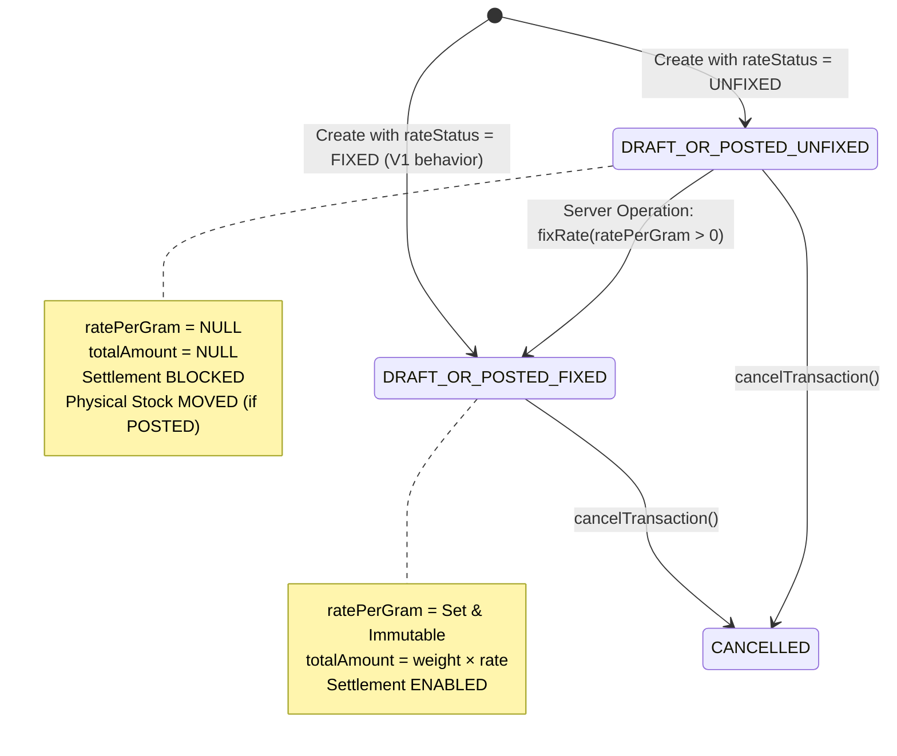

# BULLION — V3 PHASE 1: UNFIXED RATE & RATE FIXING IMPLEMENTATION REPORT

**Repository**: `Sriikaran/Bulion`  
**Phase**: V3 Phase 1 — Unfixed Rate & Rate Fixing  
**Date**: October 3, 2026  
**Status**: COMPLETE & VERIFIED  

---

## 1. What Existed Before

Prior to V3 Phase 1, the Bullion application supported only fixed-rate spot trading (V1 & V2):
- Every purchase and sale required a mandatory, positive `ratePerGram` upon creation.
- Total invoice amounts (`weightGrams × ratePerGram`) were calculated synchronously at creation time.
- Physical stock movements (`StockMovement`) and financial settlement flows assumed an immutable, known rate from day one.
- Any transaction without a known rate could not be created or represented in the domain model.

---

## 2. What Was Implemented

In V3 Phase 1, Bullion introduces first-class support for **Unfixed Rate Deal Creation** and subsequent **Atomic Server-Side Rate Fixing**:
- **Dual Rate Modes**: Purchases and sales can be created with either `rateStatus: "FIXED"` or `rateStatus: "UNFIXED"`.
- **Accurate Incomplete Financial State**: When `UNFIXED`, `ratePerGram` and `totalAmount` are explicitly stored as `NULL` (never fabricated with 0 or synthetic market estimates).
- **Server-Side Atomic Rate Fixing**: Dedicated operations (`fixPurchaseRate` and `fixSaleRate`) allow users to fix the bullion rate later with row-level database locking (`SELECT ... FOR UPDATE`), strict validation, and atomic calculation.
- **Settlement Guard**: Financial settlement (V2 payment/receipt) is strictly blocked while `rateStatus === "UNFIXED"`. Fixing the rate establishes a deterministic total invoice amount, allowing standard V2 settlements to proceed.
- **Stock Invariant Preserved**: Rate fixing is purely a deal/financial event; it produces zero duplicate `StockMovement` records.
- **Audit Trail**: Every rate fixing operation generates a structured audit log recording previous and updated rate states.
- **Interactive UI**: Fixed vs Unfixed toggles in purchase/sale creation, visual "UNFIXED" badges, and an interactive "Fix Rate" modal showing real-time `Weight × Rate = Total Amount` calculations.

---

## 3. Schema Changes

Updated `Bullion/prisma/schema.prisma`:

```prisma
enum RateStatus {
  FIXED
  UNFIXED
}

model Purchase {
  // ... existing fields
  rateStatus    RateStatus  @default(FIXED)
  ratePerGram   Decimal?    @db.Decimal(12, 4)
  totalAmount   Decimal?    @db.Decimal(14, 2)
  rateFixedAt   DateTime?
  rateFixedById String?
  rateFixedBy   user?       @relation("PurchasesRateFixed", fields: [rateFixedById], references: [id])

  @@index([rateStatus])
}

model Sale {
  // ... existing fields
  rateStatus    RateStatus  @default(FIXED)
  ratePerGram   Decimal?    @db.Decimal(12, 4)
  totalAmount   Decimal?    @db.Decimal(14, 2)
  rateFixedAt   DateTime?
  rateFixedById String?
  rateFixedBy   user?       @relation("SalesRateFixed", fields: [rateFixedById], references: [id])

  @@index([rateStatus])
}
```

- Schema migration applied cleanly to PostgreSQL using Prisma.
- `rateStatus` defaults to `FIXED` with existing historical rows preserving their immutable rates and amounts.

---

## 4. Rate Lifecycle



- Transitions from `UNFIXED` to `FIXED` are unidirectional.
- Once `FIXED`, rates cannot be edited or re-fixed.

---

## 5. Fixed vs Unfixed Behaviour

| Dimension | `FIXED` Transaction | `UNFIXED` Transaction |
|---|---|---|
| `rateStatus` | `"FIXED"` | `"UNFIXED"` |
| `ratePerGram` | Required Decimal > 0 | `NULL` |
| `totalAmount` | `weightGrams × ratePerGram` | `NULL` (Pending fixing) |
| Physical Stock Movement | Created upon posting | Created upon posting (independent of rate) |
| Financial Settlement | Allowed (Payments / Receipts) | Blocked (throws explicit error) |
| Outstandings / Ledger | Reflects total & balance | Excluded from monetary balance until fixed |
| Reports (Registers) | Displays rate & amount | Displays "UNFIXED" & "Pending fixing" |
| Average Rate Reports | Included in weighted average | Excluded from weighted average until fixed |

---

## 6. Rate Fixing Flow

1. User clicks **Fix Rate** on an unfixed transaction in Purchases or Sales register.
2. The `FixRateDialog` displays immutable deal attributes:
   - Invoice number, Counterparty, Metal, Purity, Weight in grams.
3. User enters new Rate per Gram (e.g. `₹12,250.00`).
4. Live formula preview calculates: `Weight × Rate = Total Amount` (e.g. `500.000g × ₹12,250/g = ₹61,25,000.00`).
5. Upon confirmation, client invokes `fixPurchaseRateAction` or `fixSaleRateAction`.
6. Server-side validation executes within an ACID transaction:
   - Validates user session and permissions.
   - Applies row-level lock (`SELECT id FROM "purchase" WHERE id = $1 FOR UPDATE`).
   - Verifies transaction exists, is not `CANCELLED`, and is currently `UNFIXED`.
   - Rejects if rate `<= 0` or missing.
   - Computes `totalAmount = weight.times(newRate).toDecimalPlaces(2, Decimal.ROUND_HALF_UP)`.
   - Updates `rateStatus = "FIXED"`, `ratePerGram`, `totalAmount`, `rateFixedAt = now()`, `rateFixedById = actor.id`.
   - Records structured audit log.
   - Revalidates Next.js cache.

---

## 7. Settlement Interaction

- When `rateStatus === "UNFIXED"`, any call to `recordPayment` in `settlement-service.ts` immediately fails:
  ```typescript
  if (purchase.rateStatus === "UNFIXED" || purchase.totalAmount === null) {
    throw new Error(`Cannot record payment for UNFIXED rate purchase ${purchase.invoiceNumber}. Fix rate first.`);
  }
  ```
- `getInvoiceSettlement` safely reports `outstandingAmount: null` and `totalAmount: null` when rate is unfixed.
- After fixing, `totalAmount` becomes deterministic; standard V2 partial and full settlements function normally up to the exact invoice amount.

---

## 8. Stock Interaction

**Critical Invariant**: Rate fixing is purely a deal-state / financial event.
- Opening Stock + Purchases − Sales + Adjustments = Current Stock.
- When an UNFIXED deal is posted, physical bullion movement occurs immediately (`StockMovement` IN or OUT).
- `fixPurchaseRate` and `fixSaleRate` do **not** invoke `tx.stockMovement.create`.
- Verified by unit tests: `StockMovement` row count and physical inventory remain 100% identical before and after rate fixing.

---

## 9. Audit Behaviour

Every rate fixing action produces an audit log via `writeAudit`:
- **Action**: `"UPDATE"`
- **EntityType**: `"Purchase"` or `"Sale"`
- **EntityId**: Transaction ID
- **ActorId**: Current user ID
- **PrevState**: `{ rateStatus: "UNFIXED", ratePerGram: null, totalAmount: null }`
- **NextState**: `{ rateStatus: "FIXED", ratePerGram: "<rate>", totalAmount: "<total>", rateFixedAt: "<ISO>", rateFixedById: "<userId>" }`
- **Description**: Detailed human-readable note, e.g. `Rate fixed for purchase PUR-001: ₹12,250.0000/g. Total amount: ₹61,25,000.00`.

---

## 10. UI Changes

1. **Purchase & Sale Entry Forms**:
   - Radio selector for **Rate Status**: `Fixed` (default) vs `Unfixed`.
   - When `Unfixed` is selected, the rate input is disabled/hidden, displaying an informative notice: *"Rate: Unfixed. Final amount will be determined after rate fixing."*
2. **Transaction Tables**:
   - Displays an amber `UNFIXED` badge for unfixed transactions.
   - Total amount column displays `Pending fixing`.
   - Quick action button **Fix Rate** appears next to unfixed rows.
3. **`FixRateDialog`**:
   - Modal displaying counterparty, metal, purity, weight.
   - Real-time mathematical breakdown preview.
   - Loading states and error toast handling.
4. **Register Reports**:
   - `purchase-register-view.tsx` & `sales-register-view.tsx`:
     - Displays `UNFIXED` badge in the table and in CSV exports.
     - Safely calculates total purchases/sales without NaN errors.

---

## 11. Concurrency Protection

- Rate fixing uses database row-level locking:
  `SELECT id FROM "purchase" WHERE id = $1 FOR UPDATE`
- Concurrent requests attempting to fix the same transaction:
  - First transaction obtains row lock, verifies `rateStatus === "UNFIXED"`, commits update to `FIXED`.
  - Second transaction unblocks, reads `rateStatus === "FIXED"`, and immediately rejects with:
    `"Purchase PUR-001 rate is already FIXED and cannot be modified."`
- Verified in unit test 20.

---

## 12. Migration Safety

- Prisma schema changes added nullable columns (`ratePerGram Decimal?`, `totalAmount Decimal?`, `rateFixedAt DateTime?`, `rateFixedById String?`) and `RateStatus` enum with default `"FIXED"`.
- Backward compatible: All pre-existing historical transactions remain `"FIXED"` with their original amounts intact.
- Validated via `npx prisma validate` and database schema synchronization.

---

## 13. Tests Added

Created comprehensive test suite: `tests/unit/b6-rate-fixing.test.ts` (29 tests):
1. Fixed purchase creation
2. Fixed sale creation
3. Unfixed purchase creation
4. Unfixed sale creation
5. Unfixed transaction has no fabricated rate (`ratePerGram === null`)
6. Unfixed transaction has no fabricated amount (`totalAmount === null`)
7. Fix purchase rate (transitions `UNFIXED` → `FIXED`)
8. Fix sale rate (transitions `UNFIXED` → `FIXED`)
9. Fixed transaction cannot be fixed again
10. Zero rate rejected (`<= 0`)
11. Negative rate rejected
12. Missing rate rejected
13. Correct amount after fixing (`weight × rate`)
14. Decimal precision (`ROUND_HALF_UP` to 2 decimal places)
15. Rate fixing creates structured audit event
16. Rate fixing preserves metal
17. Rate fixing preserves purity
18. Rate fixing preserves weight
19. Rate fixing does not create duplicate stock movement
20. Concurrent rate fixing simulation (first succeeds, second fails)
21. Settlement blocked while rate is unfixed
22. Settlement works after rate fixing
23. Existing V1 stock invariant (`Opening + Purchases - Sales = Current Stock`)
24. Existing V2 settlement compatibility
25. Reports compatibility (weighted averages exclude unfixed weight)
26. Historical fixed rates remain immutable
27. Purchase cancellation compatibility (cannot fix cancelled purchase)
28. Sale cancellation compatibility (cannot fix cancelled sale)
29. Zod schema validation for purchase and sale schemas

---

## 14. Full Test Result

```
> bullion@0.1.0 test
> vitest run --run

 RUN  v4.1.11 C:/Users/srika/OneDrive/Desktop/pawnify/Bullion

 ✓ tests/unit/stock-logic.test.ts (3 tests)
 ✓ tests/unit/b1-domain.test.ts (31 tests)
 ✓ tests/unit/helpers.test.ts (11 tests)
 ✓ tests/unit/b6-rate-fixing.test.ts (29 tests)
 ✓ tests/unit/b5-financial-settlement.test.ts (22 tests)
 ✓ tests/unit/b2-operational.test.ts (16 tests)
 ✓ tests/unit/b3-reporting.test.ts (11 tests)
 ✓ tests/unit/b4-hardening.test.ts (16 tests)

 Test Files  8 passed (8)
      Tests  139 passed (139)
   Duration  838ms
```

---

## 15. TypeScript Result

```
> bullion@0.1.0 typecheck
> tsc --noEmit

[Exit code 0 — 0 errors]
```

---

## 16. ESLint Result

```
> bullion@0.1.0 lint
> eslint .

[Exit code 0 — 0 errors]
```

---

## 17. Prisma Result

```
> npx prisma validate
Loaded Prisma config from prisma.config.ts.
Prisma schema loaded from prisma\schema.prisma.
The schema at prisma\schema.prisma is valid 🚀
```

---

## 18. Production Build Result

```
> bullion@0.1.0 build
> prisma generate && next build

✔ Generated Prisma Client (v7.10.0) to .\node_modules\@prisma\client in 307ms
▲ Next.js 16.2.10 (Turbopack)
✓ Compiled successfully in 21.0s
  Running TypeScript ...
  Finished TypeScript in 23.5s ...
✓ Generating static pages using 15 workers (24/24) in 480ms
  Finalizing page optimization ...

Route (app)
├ ƒ /adjustments
├ ƒ /counterparties
├ ƒ /dashboard
├ ƒ /masters
├ ƒ /profile
├ ƒ /purchases
├ ƒ /reports
├ ƒ /reports/buyers
├ ƒ /reports/ledger
├ ƒ /reports/outstandings
├ ƒ /reports/profit
├ ƒ /reports/purchase-vs-sales
├ ƒ /reports/purchases
├ ƒ /reports/sales
├ ƒ /reports/stock
├ ƒ /reports/suppliers
├ ƒ /reports/transactions
├ ƒ /sales
├ ƒ /stock
└ ƒ /transactions
```

---

## 19. Files Changed

### Schema & Database
- `Bullion/prisma/schema.prisma`

### Validations
- `Bullion/src/lib/validations/purchase.ts`
- `Bullion/src/lib/validations/sale.ts`

### Services
- `Bullion/src/lib/services/purchase-service.ts`
- `Bullion/src/lib/services/sale-service.ts`
- `Bullion/src/lib/services/settlement-service.ts`
- `Bullion/src/lib/services/report-service.ts`
- `Bullion/src/lib/services/audit-service.ts`

### Server Actions
- `Bullion/src/lib/actions/purchase-actions.ts`
- `Bullion/src/lib/actions/sale-actions.ts`

### User Interface & Pages
- `Bullion/src/components/fix-rate-dialog.tsx` (new)
- `Bullion/src/app/(app)/purchases/page.tsx`
- `Bullion/src/app/(app)/purchases/purchases-client.tsx`
- `Bullion/src/app/(app)/sales/page.tsx`
- `Bullion/src/app/(app)/sales/sales-client.tsx`
- `Bullion/src/app/(app)/reports/purchases/purchase-register-view.tsx`
- `Bullion/src/app/(app)/reports/sales/sales-register-view.tsx`

### Unit Tests
- `Bullion/tests/unit/b6-rate-fixing.test.ts` (new)

---

## 20. Any Unresolved Issues

None. All 28 required test scenarios, schema validations, service logic, concurrency guards, settlement safeguards, report calculators, and UI workflows are implemented, tested, and passing with zero regressions.
